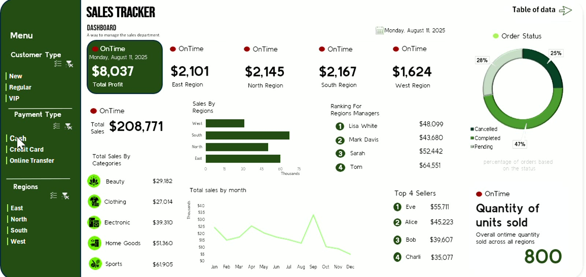
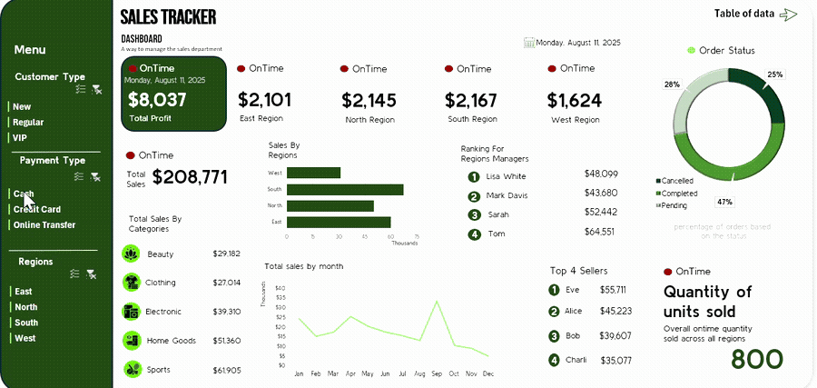
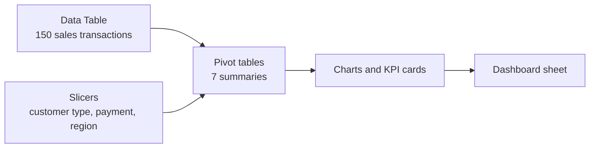

# Dynamic Sales Tracker Dashboard (Excel)

A fully interactive sales tracker built in Microsoft Excel. It lets a sales team monitor sales, profit and order status by region, category, sales representative and customer type, with one-click filtering through slicers.




## Problem

Sales managers need a single view of performance that they can slice quickly, without writing formulas or rebuilding charts: which regions and categories drive revenue, who the top sellers are, and how many orders are completed, pending or cancelled.

## Objectives

- Summarize total sales, total profit and units sold in one screen.
- Compare regions, product categories, sales representatives and regional managers.
- Track order status (completed, pending, cancelled).
- Let users filter everything at once by customer type, payment method and region.

## Demo



The full screen recording is in [`Screen Recording 2025-08-11 180909.mp4`](Screen%20Recording%202025-08-11%20180909.mp4).

## Features

| Area | What it shows |
|---|---|
| KPI cards | Total profit, profit by region (East, North, South, West), total sales, quantity of units sold |
| Sales by region | Bar chart comparing the four regions |
| Sales by category | Beauty, Clothing, Electronics, Home Goods, Sports |
| Rankings | Regional managers ranked by sales, top 4 sellers |
| Trend | Total sales by month |
| Order status | Share of completed, pending and cancelled orders |
| Slicers | Customer type (New, Regular, VIP), payment method (Cash, Credit Card, Online Transfer), region |

## Workflow



1. **Data table**: 150 transactions with date, product, category, sales representative, region, quantity, unit price, total sale, cost, profit, payment method, order status, regional manager and customer type.
2. **Pivot sheet**: seven pivot tables aggregate the data for each visual.
3. **Dashboard sheet**: charts and KPI cards read from the pivots; slicers connected to all pivots filter the whole dashboard together.

## Tools

- **Microsoft Excel**: tables, pivot tables, pivot charts, slicers, dashboard design

## How to use

1. Download `Dynamic dashboards (1).xlsx` and open it in Excel (desktop version recommended for slicers).
2. Use the slicers in the left menu to filter by customer type, payment method or region.
3. To use your own data, replace the rows in the **Data Table** sheet with the same columns, then select **Data → Refresh All**.

## Repository contents

```
Dynamic dashboards (1).xlsx           The dashboard workbook (Dashboard, Data Table, Pivot sheets)
Data table (1).xlsx                   The raw data table on its own
Screen Recording 2025-08-11 ...mp4    Video walkthrough
images/                               Screenshot and GIF used in this README
```

---

📫 Lina Amer · [LinkedIn](https://www.linkedin.com/in/linaamer1) · [linaamer1312@gmail.com](mailto:linaamer1312@gmail.com) · Available for freelance Excel and Power BI dashboard projects
